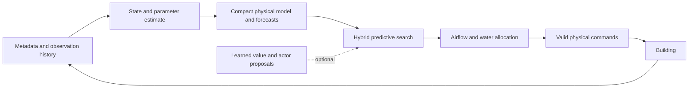

# Algorithm research and proposed control architecture

Research date: 2026-10-19. Status: a sourced design proposal, not an implemented
or benchmarked improvement. Required reference:
[MATHEMATICAL_FRAMEWORK.md](MATHEMATICAL_FRAMEWORK.md), especially Sections 1–9.

## 1. Recommendation and evidence limits

The strongest candidate to investigate is **adaptive economic model predictive
control with a compact physical model, state estimation, explicit binary mode
search, and physical actuator allocation**. Add an ensemble, graph-based learned
corrections, and a learned terminal value only when experiments justify them.

This combines existing ideas from economic MPC/MHE, physics-constrained building
modeling, PETS, iCEM, and TD-MPC. It is our proposed adaptation to this simulator,
not an existing algorithm already demonstrated to win this competition. No
comparison performed here establishes which method is best on the hidden set.

### Web research actually performed

The environment proxy returned HTTP 403 for arXiv, Google, Bing, PMLR,
NeurIPS proceedings, OpenReview, and the Locus Lab project-site host. GitHub and
raw GitHub were accessible. Research therefore used live GitHub searches,
author-maintained research repositories, implementation code, and published
building-control notebooks. The linked papers were identified through those
sources; their blocked full texts were not read during this session. This is a
substantial primary-implementation investigation with restricted literature
coverage, not an exhaustive review of all work through 2026.

Retrieved source snapshots, URL/status manifests, and numerical derivation checks
are saved outside the checkout in
`/workspace/smart-buildings-research/algorithm-research/`. The source register in
Section 12 distinguishes what was inspected from what was only identified.

## 2. Why an exact universally optimal algorithm is unavailable

Write the available history as $\mathcal I_t=(m,o_{0:t},u_{0:t-1})$. The correct
information state is a belief over physical state, unknown building parameters,
occupancy allocation, and disturbance regime:

$$
\beta_t=p(x_t,\vartheta,n_t,\zeta_t\mid\mathcal I_t).
$$

An exact finite-horizon POMDP solution would satisfy

$$
V_t^*(\beta)=\min_{u\in\mathcal U(m)}
\left\{\mathbb E[\ell_t\mid\beta,u]
+\mathbb E_{o'}\left[V_{t+1}^*(\mathcal B(\beta,u,o'))\right]\right\},
\qquad V_H^*=0. \tag{R1}
$$

Here $\mathcal B$ is Bayesian filtering. Both the continuous belief space and the
hybrid action space are large; their transition law and test distribution are
partly unknown. Full binary sequence enumeration alone costs $2^{(K+1)H}$.
Solving an approximate deterministic planner globally would still not prove
optimality for this partially observed stochastic problem.

The practical goal is to spend approximation error deliberately:

$$
\text{state estimation} + \text{model error} + \text{forecast error}
+\text{planning restriction} +\text{numerical search error}
+\text{test-distribution mismatch}.
$$

These are error sources, not an asserted additive performance theorem. Each
requires a separate diagnostic or ablation.

## 3. What existing algorithms offer, and where direct adaptation fails

### 3.1 Linear/quadratic MPC and economic nonlinear MPC

Classical linear MPC solves a problem such as

$$
\min_{u_{0:N-1}}\sum_j\|x_j-r_j\|_Q^2+\|u_j\|_R^2,
\qquad x_{j+1}=Ax_j+Bu_j.
$$

Our actual heat delivery contains

$$
Q_i=\rho_ac_a f_i(T_i^{\rm sup}-T_i),
\quad f_i\propto d_i\sqrt{p_k},
\quad T_k^{\rm ahu}=\min(T_k^{\rm mix},\tau_k),
$$

plus binary switches, shared capacity and reheat saturation. The Hessian of a
bilinear term $fT$ with respect to $(f,T)$ is

$$
\nabla^2(fT)=\begin{bmatrix}0&1\\1&0\end{bmatrix},
$$

with eigenvalues $\{-1,1\}$. Furthermore, the actual comfort loss is nonconvex:

$$
\phi(5)=1>
\frac{\phi(4.9)+\phi(5.1)}2=0.9902.
$$

**Intuition:** a convex quadratic controller solves a useful approximation; it
does not preserve the full equipment behavior or competition cost automatically.

**Adaptation:** economic nonlinear MPC with the actual stage cost, state/parameter
estimation, and fixed-mode sequential convexification or nonlinear optimization.
Linearize only inside a trust region. For a bilinear term the omitted local
remainder is $\delta f\,\delta T$, so bounding both increments controls this
part of the approximation. Re-evaluate finalists with the unsmoothed actuator
model and exact piecewise cost. Global optimality and general closed-loop
stability do not follow from these steps. Sources: [S1], [S2], [S3].

### 3.2 Mixed-integer MPC

Binary variables can represent equipment run commands and piecewise regimes.
However, modeling products and square roots accurately gives a mixed-integer
nonlinear problem, not automatically an MILP or convex MIQP.

$$
\#\text{mode sequences}=2^{(K+1)N}.
$$

For $K=4$, even a 48-step planning horizon has $2^{240}$ schedules. Branch-and-bound
need not enumerate all of them, but worst-case computation remains a problem.

**Adaptation:** short-horizon mixed-integer solutions as offline teacher/oracle
diagnostics on a reduced model; online beam/coordinate search over real binary
modes, with continuous optimization conditioned on each mode candidate. Move
blocking reduces search size at the cost of excluding some schedules. Minimum
on/off dwell times may be useful search regularizers; they are not additional
competition constraints unless independently verified. Source: [S4].

### 3.3 DeePC / subspace predictive control

DeePC constructs trajectories from input/output data using Hankel matrices:

$$
\begin{bmatrix}U_p\\Y_p\\U_f\\Y_f\end{bmatrix}g
=\begin{bmatrix}u_{\rm ini}\\y_{\rm ini}\\u\\y\end{bmatrix}.
$$

The classical exact representation depends on assumptions such as a controllable
LTI system, sufficient history, and persistently exciting data. For input
dimension $m_u$, trajectory length $L$, and state dimension $n_x$, persistent
excitation of order $L+n_x$ requires at least

$$
T\geq(m_u+1)(L+n_x)-1
$$

samples in the standard single-trajectory setting. This is a necessary size
condition for full row rank, not sufficient excitation. Counting the 92
continuous and five binary command channels as 97 input coordinates illustrates
the scale: at $L=48,n_x=80$, the bound is $12543$ samples. These are illustrative
dimensions, not a claim that our hybrid plant satisfies the theorem.

PID data can also be rank-deficient: saturated/inactive actions contribute little
independent excitation. Data from different buildings cannot simply be placed in
one Hankel matrix and treated as one LTI system.

**Intuition:** avoiding explicit identification does not remove the need for
informative data or a valid dynamics class.

**Adaptation:** local-mode low-dimensional DeePC/SPC, after physical input
reduction and regularization, is a useful challenger. Nonlinear/kernel variants
could be studied if it wins local tests. Their existence does not provide exact
cross-building guarantees. Explicit compact identification is the simpler first
choice here. Source: [S5].

### 3.4 PETS and iCEM / sampling-based predictive control

PETS supplies an ensemble-based predictive-control template; iCEM adds correlated
action samples and reuse of elite trajectories. For an action sequence $U$:

$$
\widehat J(U)=\frac1P\sum_{p=1}^{P}
\left[\sum_{j=0}^{N-1}\ell(\widehat x_j^p,u_j,w_j^p)
+\widehat V(\widehat x_N^p)\right].
$$

Raw search is still expensive: building 1 gives $48\times92=4416$ continuous
coordinates before binary decisions. Smooth Gaussian sampling of on/off values
is physically wrong; thresholding later can materially change the trajectory.
Ensembles can agree and still share the same modeling error.

**Adaptation:** sample reduced physical/supervisory controls, preserve binary
commands during every prediction, warm-start from PID and the previous plan, and
use a compact dynamics model rather than the full thermal-grid simulator inside
the online search. Treat ensemble uncertainty as a calibrated heuristic, not a
proof. Sources: [S6], [S7].

### 3.5 TD-MPC2 and DreamerV3

These provide useful world-model, actor, and value-learning ideas. The inspected
TD-MPC2 implementation samples actor trajectories, refines action sequences, and
adds a learned terminal value. Its published implementation targets continuous
control; its multi-task path uses task embeddings/action masks for a specified
task collection. It also uses discounted value targets.

Our building sizes change, there is no supplied scenario ID, commands are hybrid,
observations omit thermal state, and scoring is undiscounted. Copying its network,
discount heuristic, or task-index embedding would therefore change important
assumptions. Dreamer-style recurrent inference addresses history, but still needs
a metadata-aware hybrid actor and adequate data coverage.

**Adaptation:** borrow the learned terminal value and actor proposal, not the
entire unmodified agent. Use graph/set representations, history-dependent
inference, and cost targets aligned with the finite-horizon undiscounted score.
An ordinary discounted critic can be an explicitly labeled training surrogate;
it is not the exact remaining competition cost. Sources: [S8], [S9].

### 3.6 Differentiable predictive control and policy distillation

DPC learns a policy by differentiating through modeled rollouts. Author-maintained
examples include building control, RC identification, and mixed-integer control.
These are unusually relevant starting points. However, the inspected building
tutorial uses a simplified linear building and different tracking/energy terms;
its mixed-integer tutorial is a conceptual two-state thermal-storage example.
Neither is an implementation of our simulator's complete optimization problem.

Discrete commands have zero derivative almost everywhere under hard thresholding.
A soft command $b\in(0,1)$ does not generally satisfy

$$
F(x,b)=bF(x,1)+(1-b)F(x,0).
$$

State coupling, floors, water dynamics, and thermal integration prevent that
identity in general. Gumbel/straight-through estimators are biased surrogates
for a hard switching system.

**Adaptation:** use DPC for warm starts or fast deployment after a good teacher is
established. Train separate real mode decisions and continuous outputs; evaluate
the hard decisions. Collect student-visited states and relabel them with the
teacher (dataset aggregation) to reduce imitation distribution shift. A learned
policy's small training loss does not certify closed-loop performance. Sources:
[S3], [S4], [S10].

### 3.7 Model-free hybrid RL

A recurrent, factored hybrid actor is possible:

$$
\pi(b,a\mid\mathcal I)=\pi_b(b\mid\mathcal I)
\pi_a(a\mid b,\mathcal I).
$$

Parameterized-action RL supplies related ideas, but choosing one categorical
action with parameters is not identical to jointly switching several AHUs and
one shared water system. Enumerating all joint discrete actions scales as
$2^{K+1}$. Independent binary heads lose interactions unless the critic and
conditioning recover them.

**Adaptation:** a recurrent graph actor and centralized cost/value critic, trained
with domain randomization and a PID/teacher initialization, is a serious later
challenger. It is less attractive as the first departure from V0 because simulator
rollouts are expensive and the physical structure is already available. Sources:
[S11], [S12].

## 4. Additional information limitation: reward inputs are partly hidden

Framework Sections 3 and 5 imply an important distinction:

$$
o_t\supset N_t=\sum_i n_{i,t},\qquad
o_t\not\supset(n_{1,t},\ldots,n_{V,t}).
$$

For example, the same measured zone temperatures with
$\phi(d_1)=0.2,\phi(d_2)=0$ and total occupancy ten give

$$
C=0.2\quad\text{if }(n_1,n_2)=(10,0),\qquad
C=0\quad\text{if }(n_1,n_2)=(0,10).
$$

The current observation alone cannot distinguish these comfort costs. Histories
can provide indirect evidence through heat gains, but they need not identify the
instantaneous allocation exactly. Month-dependent prices and future weather also
require inference when their determining variables are not exposed.

**Adaptation:** learn conditional occupancy/price/disturbance distributions from
public training simulation. For currently observed temperatures/bands:

$$
\mathbb E[C_t\mid\mathcal I_t]=\sum_i\omega_{i,t}\phi(d_{i,t}),\qquad
\omega_{i,t}=\mathbb E\left[
\frac{n_{i,t}}{N_t}\mathbf1_{\{N_t>0\}}\mid\mathcal I_t\right]. \tag{R2}
$$

For future predictions, sample joint occupancy and thermal trajectories. Do not
silently assume independence and replace
$\mathbb E[\omega\phi(d)]$ by
$\mathbb E[\omega]\phi(\mathbb E[d])$. In particular, $\phi$ is not globally convex,
so a generic Jensen-based argument is unavailable.

A reward/cost head trained on public simulator reward labels is another option.
Those labels are available during local training; `get_action(obs)` does not
provide a live reward argument for hidden-evaluation adaptation. Equal or
area-based zone weights are useful initial priors, explicitly approximations.
Any use of privileged training labels must respect verified competition rules;
the deployed policy must use the actual participant interface.

## 5. Proposed state and model

Start with a two-temperature-per-zone resistance-capacitance model plus shared
water/equipment state:

$$
\begin{aligned}
C_i\dot T_i&=G_{io}(T_o-T_i)+G_{im}(M_i-T_i)
+\sum_jG_{ij}(T_j-T_i)+Q_i^{\rm HVAC}+q_i^{\rm int},\\
C_i^m\dot M_i&=G_{im}(T_i-M_i),\\
C_i,C_i^m&>0,\qquad G_{io},G_{im},G_{ij}\geq0.
\end{aligned} \tag{R3}
$$

Use symmetric nonnegative $G_{ij}$ for passive pairwise thermal exchange. These
conditions encode useful physical structure; they do not prove that a two-node
model reproduces the full thermal grid. Use implicit discretization and the actual
public equipment maps for heat delivery. Add a small learned residual only if
multi-step errors require it; an unconstrained residual can invalidate the passive
structure.

Estimate hidden mass temperatures and a small subset of parameters using moving
horizon estimation, an EKF/ensemble filter, or constrained recursive least squares
where the chosen parametrization is linear:

$$
\min_{\widehat x,\vartheta}
\|\widehat x_{t-L}-\overline x\|_{P^{-1}}^2
+\sum_{j=t-L}^{t}\|o_j-\widehat h(\widehat x_j)\|_{R^{-1}}^2
+\sum_{j=t-L}^{t-1}\|
\widehat x_{j+1}-\widehat F_\vartheta(\widehat x_j,u_j)\|_{Q^{-1}}^2
+\lambda\|\vartheta-\vartheta_{\rm prior}(m)\|^2. \tag{R4}
$$

**Identification limitation:** if $y=\Phi\vartheta+\varepsilon$ and
$\operatorname{rank}\Phi<\dim\vartheta$, multiple parameters fit the same data.
Passive operation in a narrow comfort band may not excite every thermal mode.
Use informative training rollouts, parameter sharing and regularization; carry
uncertainty instead of claiming all physical parameters are recoverable online.
Costly exploration during scored evaluation is not automatically beneficial.

The exact belief-space solution (R1) also values information: an action changes
both the building and what subsequent observations reveal about its parameters.
A planner that propagates fixed parameter particles without modeling future
belief updates omits this dual-control effect. Deliberate probing could help,
but an information-gain bonus is only a surrogate for future score improvement.
Begin with passive adaptation; test controlled probes only if identification
uncertainty demonstrably limits performance and their full-episode benefit exceeds
their comfort/energy cost.

Graph structure supplies variable-size transfer: zone nodes, AHU nodes, and a
shared water-system node; metadata provides zone/AHU edges. Physical adjacency
must be derived correctly from public geometry, not guessed from zone numbering.
AHU membership is not itself thermal adjacency.

Shared node functions and permutation-respecting pooling give the intended
equivariance:

$$
\pi(Po,PG)=P_u\pi(o,G), \tag{R5}
$$

where $P$ consistently relabels nodes and $P_u$ relabels corresponding actuators.
The state estimator and its memory must obey the same relabeling. Pool means and
counts as well as sums so a change in zone count is not mistaken for a change in
per-zone demand. This supports transfer, not a guarantee of extrapolation to
arbitrary buildings. Sources: [S2], [S3], [S13].

## 6. Conditional analytic reductions of actuator search

These are derivations for this plant, not claims copied from a paper or global
solutions of the full control problem.

### 6.1 Minimum pressure for fixed achievable zone airflow

For a running AHU with inactive aggregate airflow cap, let $f_i$ be target zone
airflow and $\overline f_i,p_i^d$ its design flow/pressure. Ignoring the inactive
numerical epsilon in this running regime:

$$
f_i=d_i\overline f_i\sqrt{p/p_i^d},\qquad 0.1\leq d_i\leq1.
$$

The least pressure achieving those flows is

$$
p^*=\max\left(p_{\min},\max_i p_i^d(f_i/\overline f_i)^2\right),
\qquad
d_i^*=\frac{f_i}{\overline f_i\sqrt{p^*/p_i^d}}. \tag{R6}
$$

This is valid when

$$
p^*\leq p_{\max},\quad d_i^*\in[0.1,1],\quad
\sum_i f_i\leq F^{\max}.
$$

**Reason:** $d_i\leq1$ imposes each lower pressure bound. At fixed flows and
recirculation, fan power $(2-\rho)(\sum_i f_i)p/\eta$ increases with pressure.

**Intuition:** if all dampers can open further, reducing pressure can deliver the
same air more cheaply. A fan command and all its damper commands are redundant
degrees of freedom in this conditional subproblem.

Arbitrary desired airflow vectors need not be feasible: ventilation floors can
force excess flow into some zones. If aggregate flow scaling is active, include
that regime explicitly or use the exact allocator. Equation (R6) alone is not a
complete inverse for every saturated airflow pattern.

### 6.2 Recirculation has a small conditional candidate set

Hold delivered airflow $F$, pressure $p$, return/outside temperatures, and supply
temperature command $\tau$ fixed. Ignoring reheat and future effects, instantaneous
electrical power is

$$
P_e(\rho)=(2-\rho)\frac{Fp}{\eta}
+\frac{\rho_ac_aF}{\mathrm{COP}}
\max\{\rho T_r+(1-\rho)T_o-\tau,0\}.
$$

This function is piecewise affine in $\rho\in[0,0.7]$. A minimum occurs in

$$
\left\{0,0.7,
\frac{\tau-T_o}{T_r-T_o}\ \text{if defined and in }[0,0.7]\right\}. \tag{R7}
$$

In the active mechanical-cooling branch:

$$
\frac{\partial P_e}{\partial\rho}
=-\frac{Fp}{\eta}
+\frac{\rho_ac_aF(T_r-T_o)}{\mathrm{COP}}.
$$

Thus the outside-air advantage threshold is

$$
T_r-T_o>\frac{\mathrm{COP}\,p}{\eta\rho_ac_a}.
$$

The shipped economizer already encodes a version of this tradeoff. Our added
step would evaluate these candidates jointly with predicted comfort, reheat,
water state and future cost. Those effects can introduce additional optima, so
(R7) is exact only for the stated instantaneous electrical subproblem. Use it as
a fast candidate generator rather than restricting every full-horizon optimum
to those three values.

### 6.3 Heat demand before actuator commands

Let $h_i$ be delivered reheat power:

$$
Q_i^{\rm HVAC}=\rho_ac_af_i(T_k^{\rm ahu}-T_i)+h_i.
$$

Ask the predictive thermal model for useful net heat, then allocate airflow and
water to approach it using the real device equations. This separates a zone's
thermal need from the commands that can realize it. Water temperature cannot
simply be minimized greedily: required flow, pump power, boiler losses and lag
trade against one another. Likewise, requested net heat may be physically
unreachable; project through the actual equipment constraints and retain the
resulting comfort cost.

Sanity checks verified (R6) on 1000 randomly generated feasible uncapped cases,
and (R7) against a dense recirculation grid on 1000 random fixed-state cases.
These are algebra checks, not full-simulator policy tests or performance results.

### 6.4 Increasing airflow can reduce heating

Consider a running zone coil in its water-capacity-limited regime, with neither
the effectiveness-one nor discharge-temperature cap active. Holding water flow,
water temperature and AHU inlet temperature fixed gives

$$
\epsilon_i=\frac{\rho_wc_wq_i^w}{\rho_ac_af_i}<1,
\qquad
h_i=\rho_ac_af_i\epsilon_i(T^w-T_k^{\rm ahu})
=\rho_wc_wq_i^w(T^w-T_k^{\rm ahu}).
$$

Consequently, at fixed current zone temperature,

$$
\frac{\partial Q_i^{\rm HVAC}}{\partial f_i}
=\rho_ac_a(T_k^{\rm ahu}-T_i)<0
\quad\text{when }T_k^{\rm ahu}<T_i. \tag{R10}
$$

**Intuition:** more airflow adds more cold inlet air, while water-limited reheat
cannot add more heat. A large heating error should not automatically command a
larger fan/damper setting. Different coil regimes give different derivatives; the
allocator must check the active regime rather than applying (R10) universally.

This is a concrete hypothesis for the cold-weather failure, not an established
causal diagnosis of the stored returns. Log airflow, water temperature/flow,
valves, coil effectiveness and zone heat delivery to test it. It motivates
coordinating water capacity and airflow before expensive model training.

### 6.5 Optimize marginal comfort benefit rather than a fixed midpoint

For an occupied zone just below its lower band edge, hold its occupancy weight
$\omega_i$ fixed and suppose the required gas power is $P_g(T_i)$. In a static
heating subproblem with other terms fixed:

$$
\frac{d\ell}{dT_i}
=-\frac{0.6\omega_i}{5}+\lambda_g\frac{dP_g}{dT_i}
\quad(L_i-5<T_i<L_i).
$$

Within the band the immediate comfort derivative is zero. A band-midpoint target
therefore spends energy without an immediate comfort benefit in this simplified
case. Preheating can still be justified by future occupancy, disturbances and
thermal storage, which enter the terminal/future value. Conversely, the actual
soft-cost objective can rationally tolerate discomfort when marginal energy cost
exceeds the comfort benefit. Do not replace it with an unconditional hard comfort
constraint or an arbitrary midpoint-tracking loss.

## 7. Receding-horizon optimization

Use a compact predictive belief $\widehat\beta_t$ and forecast particles covering
state, building-parameter, occupancy, and weather uncertainty. The nominal target
is

$$
\min_{\kappa\in\mathcal K}
\frac1P\sum_{p=1}^{P}\left[
\sum_{j=0}^{N-1}\ell(\widehat x_{t+j}^p,u_{t+j}^p,w_{t+j}^p)
+\widehat V_{t+N}(\widehat\beta_{t+N}^p)\right], \tag{R8}
$$

$$
u_{t+j}^p=\kappa_j(\widehat{\mathcal I}_{t+j}^p),\quad
u_{t+j}^p\in\mathcal U(m),\quad
\widehat x_{t+j+1}^p=\widehat F_{\vartheta^p}
(\widehat x_{t+j}^p,u_{t+j}^p,w_{t+j}^p).
$$

The sampled feedback plans must be nonanticipating: two particles with the same
observable history receive the same action. Giving each particle access to its
private latent state or future weather would create an oracle controller and an
optimistic planning estimate. A simpler open-loop shared sequence is a valid
restricted alternative; online replanning then provides feedback between calls.

Only the first action is applied. Update the belief from the next observation and
replan. Weather predictions must come from observed history and models trained
on public data, never direct access to the held-out future CSV.

### Practical optimizer

1. Always include the V0 feedback controller and shifted previous plan as
   candidates. Feed each forecast only the observations it is allowed to see.
2. Generate actual binary schedules using coordinate flips, a small beam, or
   Bernoulli sampling. Evaluate real $0/1$ modes throughout. Joint instantaneous
   enumeration is only $2^5=32$ for building 1, but that does not enumerate future
   schedules, and grows with AHU count.
3. Use iCEM-style correlated samples and elite reuse for continuous supervisory
   decisions. Generate local zone allocations with the physical allocator.
4. Refine promising fixed-mode plans using trust-region nonlinear/SQP steps when
   their active regimes permit meaningful derivatives.
5. Re-score candidates with exact piecewise costs and actuator maps under common
   forecast samples. Common random draws reduce noise in candidate differences.
6. Execute the best retained feasible candidate, or fall back to V0 when inference
   fails, the computation budget expires, or the estimated advantage is unreliable.

For illustration, $N=48$ five-minute predictions cover four hours. A seven-block
grid with lengths $(1,1,2,4,8,16,16)$ also totals 48. At $K=4$, the $3K+2=14$
continuous plant commands across these blocks give 98 supervisory coordinates,
compared with 4416 coordinates for an unrestricted raw continuous sequence.

That reduction requires a fixed feedback rule/allocator for zone commands. It is
a policy-class restriction, not lossless elimination of every zone decision.
If zone allocation limits performance, add zone heat/flow refinement or shared
adaptive local-policy parameters. All 48 five-minute rewards must still be
accumulated; one coarse reward per block changes the problem.

An optional uncertainty penalty, CVaR term, switching penalty, or comfort margin
is a **surrogate**. The actual competition objective remains the expected mean
loss. Start with the nominal mean, and retain additional regularization only if
it improves held-out full-episode scores. An ensemble spread threshold and V0
fallback do not prove performance dominance over V0: they can share model bias.

### Terminal value and its limits

Thermal mass effects extend beyond a short horizon. Start with a terminal rollout
under V0; later learn an undiscounted remaining-cost value with time-to-go and
belief/history features. Actor proposals and terminal-value learning are the
useful TD-MPC ideas here.

If a terminal-value approximation is uniformly within $\epsilon_V$ on relevant
terminal beliefs and all preceding dynamics/costs are exact, the corresponding
finite-horizon objective changes by at most $\epsilon_V$ per candidate; selecting
its exact minimizer costs at most $2\epsilon_V$ relative to the exact-terminal
minimizer. This elementary bound does not cover model error, approximate search,
restricted feedback plans, or the entire replanning controller. Those conditions
have not been established here.

## 8. Remaining mathematical failure modes

| Failure | Exact issue | Response and remaining limit |
| --- | --- | --- |
| Hidden thermal storage | The same air temperatures can conceal different mass temperatures and future responses | Estimate mass state from history; observability can still be weak |
| Sensor delay | A subsequent local probe verified that zone temperature is one physical step stale | Augment the estimator with sensor timing; align action effects with observations two calls later; hidden SDK timing remains unverified |
| Unknown materials | Different $C,G$ fit nearly identical passive trajectories | Regularized identification and parameter ensembles; no unique recovery without excitation |
| Missing zone occupancy | $N$ does not identify $n_i/N$ | Conditional cost model/occupancy particles; irreducible ambiguity remains |
| Forecast uncertainty | Open-loop plans optimized for one weather path can be wrong | Causal probabilistic forecasts and feedback replanning; weather cannot be predicted exactly |
| Capacity shortage | Requested $Q_i$ can lie outside attainable equipment heat/flow sets | Explicit reachability/allocation checks; accept and price unavoidable discomfort |
| Inactive actuators | Physical saturation makes action-to-state derivatives zero | Optimize effective controls; mode/candidate search across active-regime changes |
| Nonconvex comfort | The derivative drops at 5 K and large violations are unbounded | Exact scoring and regime-aware search; smoothing is only a surrogate |
| Model exploitation | A planner selects actions with favorable model error | Real-simulator validation, ensemble calibration, training-data expansion, and search trust regions |
| Transfer | Parameter and geometry distributions shift | Shared graph models and building/climate holdouts; no universal extrapolation guarantee |
| CPU/runtime | Search work grows with particles, horizon, samples and zones | Small model, batching, warm starts, sparse planning, and optional distillation |

Because comfort loss is unbounded, a small average one-step temperature error does
not give a uniform global score bound. Check multi-step errors specifically near
band edges, at schedule transitions, and during extreme violations. Do not cite a
generic bounded-cost control guarantee without establishing its hypotheses.

## 9. Computational budget

For $S$ scenarios, $H$ actions, per-step simulator time $c_{\rm env}$, controller
time $c_{\pi}$, and remaining overhead $c_0$:

$$
T_{\rm total}\simeq SH(c_{\rm env}+c_\pi)+c_0,
\qquad
c_\pi\leq\frac{B-c_0}{SH}-c_{\rm env}. \tag{R9}
$$

If $S=30,H=8640$, controller time alone totals approximately:

| Added average time/action | Added total time |
| --- | ---: |
| 1 ms | 4.32 minutes |
| 10 ms | 43.2 minutes |
| 50 ms | 3.6 hours |
| 100 ms | 7.2 hours |

The official V0 validation took about 749 seconds for 8641 reported steps on one
scenario, roughly 0.087 seconds/step including its existing overhead. It is one
measurement, not a runtime forecast for every building. The allowed final runtime
and actual hidden scenario count still need authoritative verification.

Repeated full-grid simulation inside online MPC is unlikely to fit. For example,
256 candidates, 48 predictions, five model/forecast particles and three search
iterations already request 184320 compact model transitions per planning call.
Benchmark this budget before committing to it. Replan supervisory setpoints less
often while retaining fast zone feedback, reduce populations/particles, or distill
the teacher if necessary. These changes trade computation against control quality.

## 10. Local evidence and experiment order

The committed `baseline_returns.json` gives these full-horizon local mean losses
using its fixed 8640-step denominator:

| Stored policy | Mean local loss (lower is better) |
| --- | ---: |
| `bang_bang` | 0.225203 |
| `fixed_setpoint` | 0.065915 |
| `pid` | 0.067356 |
| `pid_water` | 0.054141 |

These are stored organizer/local results, not newly reproduced runs or public
leaderboard scores. Fairbanks and Phoenix each contribute about 29% of total
stored `pid_water` loss. Useful contrasting failures include:

| Scenario | `pid_water` return | Relevant stored comparison |
| --- | ---: | --- |
| building 1 / Fairbanks | -1828.904 | `pid`: -1307.056; `fixed_setpoint`: -1274.337 |
| building 8 / Phoenix | -1365.187 | Already best among the four stored policies |
| building 5 / Singapore | -937.589 | `fixed_setpoint`: -205.948 |

The building-1 Fairbanks loss is approximately 40% higher for `pid_water` than
`pid`; building-5 Singapore shows that cold-weather repair alone is insufficient.
These returns locate failures, not their causal comfort/energy decomposition.
Selecting a policy using the scenario name or future return is not an admissible
deployed solution.

Recommended sequence:

1. Obtain the pending V0 leaderboard result and retain its notebook/version.
   Diagnose the contrasting local failures with component losses and action/state
   time series; first check SDK/configuration parity if local and gateway disagree.
2. Test one small physical improvement: heating-aware water/airflow allocation,
   economizer coordination, or schedule anticipation, chosen from that diagnosis.
   Keep a directly comparable V0 control.
3. Fit the compact thermal model from legal observations/actions. Measure held-out
   1-, 12-, 48-step prediction errors and errors through occupancy/schedule changes.
4. Add state estimation and short-horizon nominal economic MPC. Compare against
   the same controller without estimation and without planning.
5. Add uncertainty, longer-horizon terminal value, graph residuals, or online
   adaptation individually. Retain only improvements that survive held-out tests.
6. If runtime requires it, distill the validated planner. Evaluate student-only
   rollouts and teacher corrections; a good teacher does not ensure a good student.
7. Compare the final candidates at full horizon across all 30 shipped scenarios,
   plus building/climate holdouts and generated-building validation where feasible.
   Check mean loss, severe failures, runtime, and action validity. Use scarce
   leaderboard submissions to confirm selected candidates, not every parameter.

For comparable scenarios, report paired changes

$$
\Delta_s=\frac{R_s(\pi_0)-R_s(\pi_1)}{H_s}
=J_s(\pi_1)-J_s(\pi_0),\qquad
\overline\Delta=\frac1S\sum_s\Delta_s.
$$

Negative $\overline\Delta$ means improvement. Do not treat correlated steps as
independent evaluation samples. Validation by withheld building and weather
regime addresses different transfer questions; also avoid overlapping weather
windows between development and validation when generating data.

## 11. What should be built first

The first implementation should be a compact adaptive controller with a physical
allocator and a modest predictive horizon. Start without a large neural network,
large ensemble, or complicated learned terminal value. Its diagnostic logs should
answer whether the next limitation is state estimation, heating capacity,
allocation, forecast error, horizon length, or computation.

The longer-term architecture is:

This architecture addresses each difficulty with an explicit mechanism. Whether
those mechanisms improve the leaderboard is an empirical question. The first
scored baseline and controlled ablations decide how far to develop it.

## 12. Source register

All links below were retrieved during this investigation unless marked
**identified only**. Reading implementation evidence is distinct from reading the
paper's full text; external-paper links in the source repositories were generally
blocked by the environment proxy.

- **[S1]** Fiedler et al., *do-mpc: Towards FAIR nonlinear and robust model
  predictive control*, Control Engineering Practice, 2023. Inspected
  [author-maintained toolbox documentation](https://github.com/do-mpc/do-mpc):
  economic/nonlinear MPC, multistage uncertainty, and moving-horizon state and
  parameter estimation.
- **[S2]** PNNL NeuroMANCER,
  [RC-network modeling notebook](https://github.com/pnnl/neuromancer/blob/master/examples/domain_examples/NODE_RC_networks.ipynb)
  and [building neural state-space modeling code](https://github.com/pnnl/neuromancer/blob/master/examples/domain_examples/NSSM_building_dynamics.py).
  Inspected network energy balances and learned dynamical-model implementation.
- **[S3]** Drgoňa et al., *Differentiable predictive control*, Journal of Process
  Control, 2022; inspected
  [building-control notebook](https://github.com/pnnl/neuromancer/blob/master/examples/domain_examples/DPC_building_control.ipynb)
  and [project publication list](https://github.com/pnnl/neuromancer).
  Also identified there: *Physics-constrained deep learning of multi-zone building
  thermal dynamics*, Energy and Buildings, 2021.
- **[S4]** PNNL,
  [mixed-integer DPC notebook](https://github.com/pnnl/neuromancer/blob/master/examples/control/Part_6_mixed_integer_decisions.ipynb).
  Inspected conceptual thermal model and categorical/Gumbel-based decision
  machinery. It links *Learning to solve mixed-integer optimal control problems*,
  arXiv:2506.19646; paper full text **identified only**.
- **[S5]** [PyDeePC implementation](https://github.com/rssalessio/PyDeePC)
  and [DeePC/SPC relationship author repository](https://github.com/4flixt/DeePC_Perspective),
  ECC 2021. Inspected README, Hankel construction/use and optimization setup.
  Original paper *Data-Enabled Predictive Control: In the Shallows of the DeePC*,
  arXiv:1811.05890, **identified only** through the implementation.
- **[S6]** Chua et al., *Deep Reinforcement Learning in a Handful of Trials using
  Probabilistic Dynamics Models* (PETS), NeurIPS 2018. Inspected
  [MBRL-Lib documentation](https://github.com/facebookresearch/mbrl-lib),
  [PETS implementation](https://github.com/facebookresearch/mbrl-lib/blob/main/mbrl/algorithms/pets.py),
  and [model rollout evaluator](https://github.com/facebookresearch/mbrl-lib/blob/main/mbrl/models/model_env.py).
- **[S7]** Pinneri et al., *Sample-efficient Cross-Entropy Method for Real-time
  Planning*, arXiv:2008.06389. Inspected
  [author repository and algorithm explanation](https://github.com/martius-lab/iCEM),
  its controller code, and
  [MBRL-Lib CEM/MPPI/iCEM implementations](https://github.com/facebookresearch/mbrl-lib/blob/main/mbrl/planning/trajectory_opt.py).
  Reported sample-efficiency gains in that source are its benchmark results,
  not evidence of gains on this building task.
- **[S8]** Hansen, Su and Wang, *TD-MPC2: Scalable, Robust World Models for
  Continuous Control*, ICLR 2024. Inspected
  [author repository](https://github.com/nicklashansen/tdmpc2) and
  [planner/training code](https://github.com/nicklashansen/tdmpc2/blob/main/tdmpc2/tdmpc2.py),
  including proposal trajectories, discounted value estimates, and task masks.
- **[S9]** Hafner et al., *Mastering diverse control tasks through world models*,
  Nature, 2025. Inspected
  [DreamerV3 author repository](https://github.com/danijar/dreamerv3) describing
  recurrent/world-model learning and actor-critic training in imagined rollouts.
- **[S10]** Zhang et al., *Building HVAC Scheduling Using Reinforcement Learning
  via Neural Network Based Model Approximation*, BuildSys 2019. Inspected
  [official implementation documentation](https://github.com/vermouth1992/mbrl-hvac),
  which exposes PID/PPO, random-shooting MPC, and dataset-aggregation experiments.
- **[S11]** Bester et al., *Multi-Pass Q-Networks for Deep Reinforcement Learning
  with Parameterised Action Spaces*, arXiv:1905.04388. Inspected
  [implementation documentation](https://github.com/cycraig/MP-DQN), including
  parameterized-action baselines and the multi-pass construction.
- **[S12]** Janner et al., *When to Trust Your Model: Model-Based Policy
  Optimization*, NeurIPS 2019. Inspected
  [official repository documentation](https://github.com/jannerm/mbpo). This is
  relevant to learning from model-generated experience; no general guarantee for
  our hybrid/partially observed implementation is asserted.
- **[S13]** Zaheer et al., *Deep Sets*, NeurIPS 2017. Inspected
  [author repository](https://github.com/manzilzaheer/DeepSets). Permutation-aware
  pooling motivates variable-size representations; our graph controller is an
  adaptation, not the unchanged set-prediction architecture.
- **[S14]** [BOPTEST](https://github.com/ibpsa/project1-boptest) and
  [Sinergym](https://github.com/ugr-sail/sinergym): inspected building-control
  benchmark documentation. Their environments, observations and rewards differ
  from this competition; their results cannot be substituted for our validation.
- **[S15]** Drgoňa et al., *All you need to know about model predictive control
  for buildings*, Annual Reviews in Control, 2020,
  [publisher link](https://www.sciencedirect.com/science/article/pii/S1367578820300584).
  **Identified only**, through the author-maintained building-control notebook;
  full paper not retrieved in this environment.

No external implementation was installed, copied into a submission, or benchmarked
as a controller in this research task. No new Kaggle submission was made.
